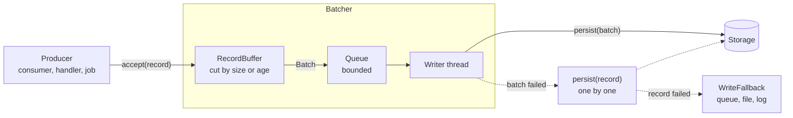
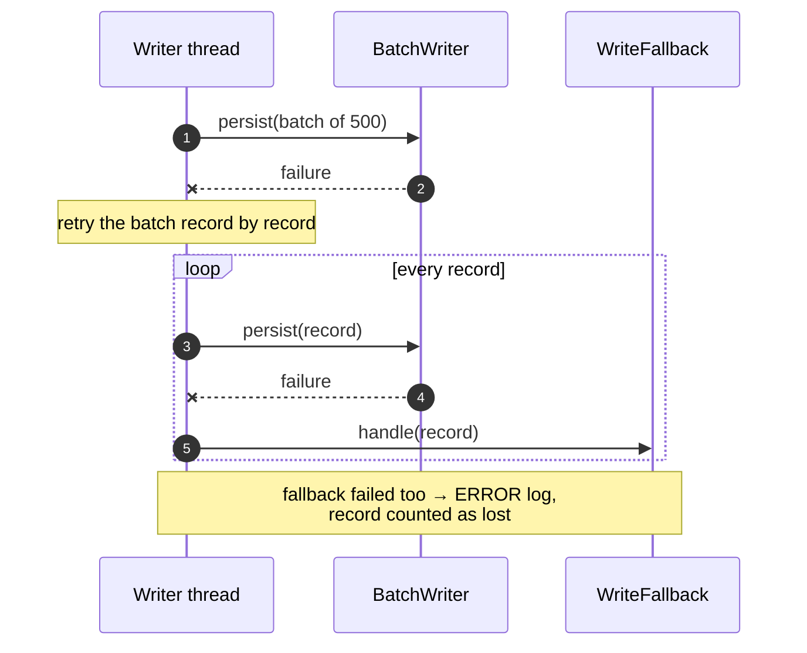
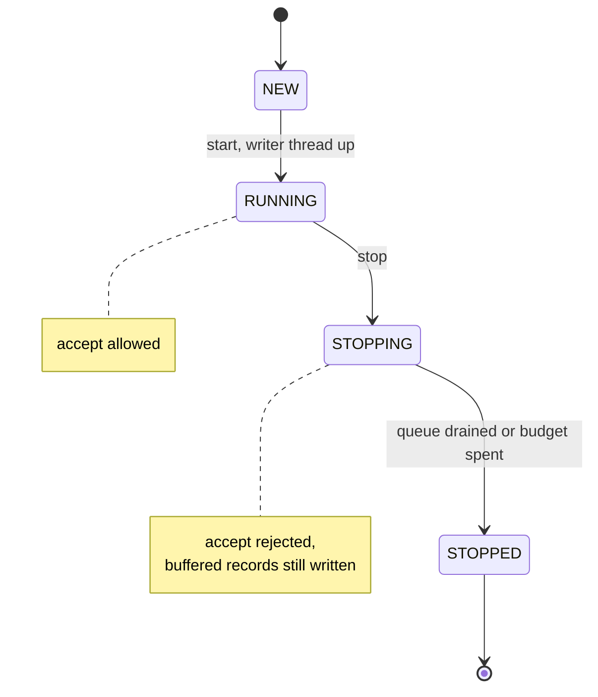
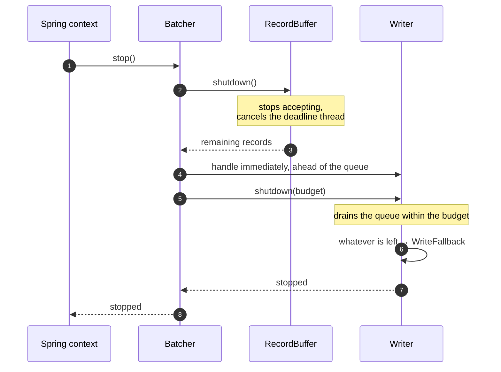
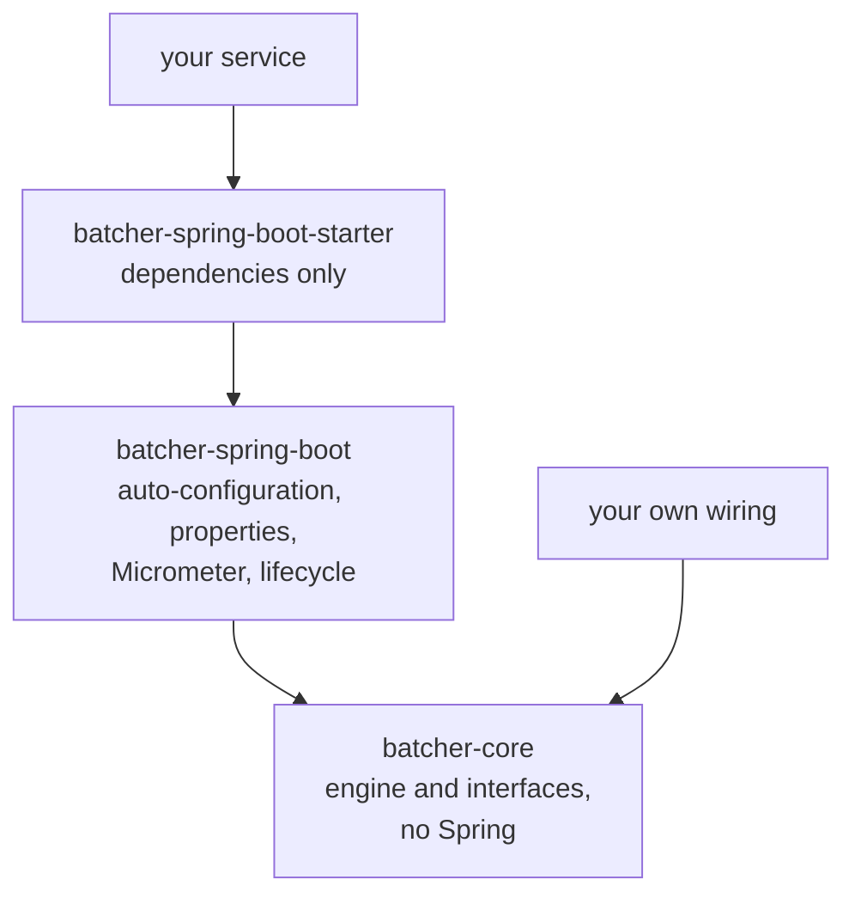

# Batcher design

A small library that turns a stream of single records into batched writes, with
its own buffer, write thread, failure recovery and metrics. Written for
ClickHouse, but it knows nothing about ClickHouse: the write itself is your code.

Contents:

1. [The problem](#1-the-problem)
2. [How ClickHouse takes inserts](#2-how-clickhouse-takes-inserts)
3. [Why `async_insert` is not always the answer](#3-why-async_insert-is-not-always-the-answer)
4. [What the library does](#4-what-the-library-does)
5. [Abstractions](#5-abstractions)
6. [Extension points](#6-extension-points)
7. [Failure handling](#7-failure-handling)
8. [Lifecycle and shutdown](#8-lifecycle-and-shutdown)
9. [Guarantees](#9-guarantees)
10. [Configuration](#10-configuration)
11. [Modules](#11-modules)
12. [Metrics](#12-metrics)
13. [Build and publishing](#13-build-and-publishing)
14. [Out of scope for v1](#14-out-of-scope-for-v1)

## 1. The problem

Records arrive one at a time: a queue consumer gets a message, an HTTP handler
gets a request, a job reads a page. The storage wants them in groups. Writing
one row per record gives you, in order of appearance:

- a round trip to the database per record, so consumer threads spend their time
  waiting;
- in ClickHouse, one data part per record (see the next section);
- no place to put a record whose write failed, so the consumer either loses it
  or rejects the message and gets it again in a loop.

Writing in groups needs more than a list and a timer:

| Need | Why |
| --- | --- |
| Cut by size and by age | A full batch must go at once; a half-full batch must not wait forever. |
| Accept while writing | The producer must not wait for the previous batch to land. |
| Bounded memory | A slow storage must not turn into an unbounded queue. |
| Attribute failures | When a batch fails, you need to know which records to retry and which to park. |
| Lose nothing on shutdown | Buffered records must be written or parked before the process exits. |
| Visible behaviour | Batch size, wait time, queue depth and lost records must be on a dashboard. |

Every service that writes to ClickHouse writes this code again. That is what
this library is.

## 2. How ClickHouse takes inserts

Each INSERT into a MergeTree table creates one data part: its own directory with
column files, indexes and metadata. Parts are merged in the background. Part
count, not row count, is the limit.

Thresholds per partition, with their documented defaults:

| Setting | Default | Effect |
| --- | --- | --- |
| `parts_to_delay_insert` | 1000 | inserts start to be slowed down |
| `max_delay_to_insert` | 1 | upper bound of that delay, in seconds |
| `parts_to_throw_insert` | 3000 | inserts fail with `TOO_MANY_PARTS` |
| `max_parts_in_total` | 100000 | the same, counted across all partitions |

The vendor's own guidance: at least 1000 rows per insert, ideally 10 000 to
100 000, and about one insert per second per table. A partition key with high
cardinality multiplies parts, because one insert touching N partitions creates
N parts.

So 2000 records a second is either 2000 parts a second, which kills the table
within minutes, or two inserts a second, which is normal load. The difference is
only where the records waited.

## 3. Why `async_insert` is not always the answer

ClickHouse can batch on its own: with `async_insert=1` the server keeps incoming
rows in memory and flushes them when a size, time or query-count threshold is
hit. Documented defaults today: `async_insert_max_data_size` 100 MiB,
`async_insert_busy_timeout_ms` 200 ms (1000 ms on Cloud),
`async_insert_max_query_number` 450, `wait_for_async_insert` 1. Those defaults
differ between versions and deployments, so read them off the server you write
to.

It solves the part-count problem. It does not solve the rest:

| | `async_insert` | Client-side batching |
| --- | --- | --- |
| Where rows wait | server memory | your process |
| Client thread with `wait_for_async_insert=1` | blocked until the server flushes | returns as soon as the record is buffered |
| Client thread with `wait_for_async_insert=0` | returns at once, no result reported | — |
| Who learns about a bad row | nobody, with `wait=0`: the error goes to the log and `system.asynchronous_inserts` | your code, with the batch in hand |
| Failed rows | no dead letter | your fallback |
| Batch boundaries | server timers, shared by all clients with the same query shape and settings | your configuration, per batcher |
| Needs server settings | yes | no |

The points that decide it in practice:

- **A blocked thread is still a blocked thread.** With `wait_for_async_insert=1`
  the insert returns only after the flush, so your consumer waits up to the
  server's timeout on every record. The thread count, not the part count,
  becomes the limit.
- **Fire-and-forget drops the result, not just the wait.** With
  `wait_for_async_insert=0` the server acknowledges a buffer, not a write. A
  parse error, a type error or a restart before the flush is something your
  service never hears about.
- **One bad row fails its whole payload.** Errors surface at flush time, and the
  failing payload is rejected as a whole. From the client you cannot tell which
  record was bad or write the rest one by one, because you no longer have them.
- **Buffers are shared.** Rows are grouped per query shape and settings, per
  node. Your batch boundaries are decided by other producers' traffic.
- **Deduplication depends on the version.** Async inserts are deduplicated the
  same way as synchronous ones only from version 26.2, per user query rather
  than per flushed batch, and plain MergeTree needs
  `non_replicated_deduplication_window` above zero.
- **Buffered rows are not queryable** until the flush.
- **Too many parts can still happen** when the partition key has high
  cardinality.

When `async_insert` alone is enough: uniform small traffic, a server you
control, and records you may lose without anyone noticing. When it is not: you
need the write result in the code that produced the record.

The two are not alternatives. Batch in the client to control size, latency and
failures; leave `async_insert` on as a second line of defence if your server
already has it.

## 4. What the library does

One batcher is a short pipeline with two threads of its own.



- `accept` takes the lock, appends to the buffer and returns. It does no I/O.
- The record that fills the batch carries it out to the queue; nothing else
  happens on the producer thread.
- A daemon thread watches the age of the oldest record and cuts a batch when the
  deadline passes.
- The queue is bounded. When it is full the batcher does not block the producer:
  it applies the back-pressure policy.
- One writer thread writes batches in order, one at a time.

## 5. Abstractions

Everything in the pipeline above is an interface in `batcher-core`.

| Type | Responsibility | Default |
| --- | --- | --- |
| `Batcher<T>` | entry point: `accept(record)`, `accept(records)`, start, stop | the only implementation |
| `Batch<T>` | records plus the arrival time of the first one | value type |
| `RecordBuffer<T>` | hold accepted records, cut batches, report a full or deadlined batch | buffer with a deadline thread |
| `BatchingPolicy` | when the buffer's content becomes a batch | size and max age |
| `BatchReadyListener<T>` | takes a cut batch from the buffer | the recovering writer |
| `BatchWriter<T>` | write a batch; write a single record | **yours**, there is no default |
| `WriteFallback<T>` | take records that could not be written | none: log at ERROR and count |
| `BackPressurePolicy` | what happens when the queue is full | hand the batch to the fallback |
| `BatcherMeter` | report every state change | disabled in core, Micrometer in the Spring module |

`BatchWriter` is the only thing you must write. It gets a `Batch<T>` and does one
insert; its single-record method is used only while recovering from a failed
batch.

## 6. Extension points

Three ways to use the library, from least to most work.

**Use it as designed.** Add the starter, declare a `BatchWriter` bean, set
`batcher.*`. Buffer, queue, writer, metrics, lifecycle and fallback behaviour
come from auto-configuration.

**Replace one part.** Declare a bean of the type you want to own and
auto-configuration steps aside for it — every bean it creates is conditional on
the absence of yours. Named batchers get their own qualifier, so one batcher can
keep the defaults while another one does not.

| Seam | Replace it when |
| --- | --- |
| `BatchWriter<T>` | always: this is your insert |
| `WriteFallback<T>` | failed records must go somewhere: a queue, a file, another table |
| `BatchingPolicy` | size and age are not your rule, for example a byte budget |
| `BackPressurePolicy` | a full queue must reject the record and let the source redeliver it, not park it |
| `BatcherMeter` | your observability is not Micrometer |
| `RecordBuffer<T>` | records must be grouped on the way in, for example per table |

**Assemble your own.** `batcher-core` has no Spring dependency. Construct the
buffer, the writer and the batcher yourself, or keep only the pieces you need
and drive them from your own code.

## 7. Failure handling

A write failure is not an exception for the producer. The batcher is already one
thread away from it, so it recovers instead.



Why one by one: a batch usually fails for one of two reasons. The storage is
unavailable, and then every record fails and goes to the fallback, or one record
is bad, and then only that one does and the other 499 land. Without the second
pass you cannot tell those apart, and you lose good records because of a bad
neighbour.

Records reach the fallback for four reasons, and each is a separate counter:

| Reason | Meaning |
| --- | --- |
| `BATCH_REJECTED` | the queue was full |
| `ENQUEUE_FAILED` | the batch could not be queued |
| `WRITE_FAILED` | the write failed, and so did the per-record retry |
| `WRITING_STOPPED` | shutdown ran out of its budget |

## 8. Lifecycle and shutdown



Shutdown is the part that decides whether you lose data on every deploy.



The batcher stops in a late Spring phase, after the message listeners, so the
sources stop producing before the buffer stops accepting.

## 9. Guarantees

What holds:

- Records are written in arrival order, by one thread, one batch at a time.
- A record is accepted or it is not: `accept` either returns, meaning the record
  is in the buffer, or throws.
- A record that cannot be written is handed to the fallback; a record is counted
  as lost only when the fallback fails too, and that is logged at ERROR.
- Shutdown writes or parks what is buffered, within a configured budget.

What does not hold:

- **Durability.** The buffer is in memory. A hard kill loses the records it
  holds. If you cannot afford that, acknowledge the source message only after
  the write, which means not using a batcher for that path.
- **Exactly once.** A batch can be written twice: the insert can succeed while
  the client sees a timeout. Deduplicate in the storage —
  `ReplacingMergeTree` with `LIMIT 1 BY <id>` on read, or an
  `insert_deduplication_token`.
- **Order between batchers.** Two named batchers are independent.

## 10. Configuration

Defaults apply to every batcher; `instances` names them and overrides what it
needs.

```yaml
batcher:
  defaults:
    batch-size: 500              # records per write
    buffering-max-duration: 1s   # how long the first record of a batch may wait
    write-queue-capacity: 16     # batches in flight before back pressure
    shutdown-await-period: 15s   # budget for draining on stop
    slow-write-duration: 5s      # a write slower than this is logged
    back-pressure: fallback      # fallback | reject
  instances:
    history:
      batch-size: 2000
    audit:
      buffering-max-duration: 5s
      back-pressure: reject
```

Two numbers set the shape of the load: `batch-size` and
`buffering-max-duration`. Rows per second at full load is
`batch-size / buffering-max-duration`, and that is also the worst-case delay
before a record is queryable. Pick the delay you can live with, then the size
that keeps inserts at roughly one per second per table.

`write-queue-capacity` is the memory bound:
`batch-size * (write-queue-capacity + 1)` records at most.

Each named instance gets its own metrics tag, its own threads and its own
`BatchWriter` bean, resolved by qualifier.

## 11. Modules



| Module | Contains | Depends on |
| --- | --- | --- |
| `batcher-core` | the pipeline and every interface | `slf4j-api` only |
| `batcher-spring-boot` | auto-configuration, configuration properties, Micrometer meter, Spring lifecycle | core, Spring Boot, Micrometer as optional |
| `batcher-spring-boot-starter` | nothing but dependencies | the two above and `spring-boot-starter` |

The naming follows the Spring Boot reference: a module of your own is
`<name>-spring-boot`, the starter is `<name>-spring-boot-starter`, and nothing
starts with `spring-boot`. Configuration keys live under `batcher`, not under
`spring`.

## 12. Metrics

Micrometer, prefix `batcher`, every series tagged with the batcher name.

| Series | Type | Tags | Answers |
| --- | --- | --- | --- |
| `batcher.acceptance` | counter, records | `result` | are records being rejected? |
| `batcher.records` | counter, records | `result` | written, parked or lost? |
| `batcher.buffer.records` | gauge, records | | how full is the buffer? |
| `batcher.buffer.age` | gauge, seconds | | how long has the oldest record waited? |
| `batcher.buffer.dispatched` | counter, batches | `reason` | cut by size or by deadline? |
| `batcher.batch.write` | timer | `mode` | how slow are writes, and how often do we recover? |
| `batcher.batch.size` | distribution summary, records | | are batches full? |
| `batcher.writer.queue.size` | gauge, batches | | is the storage keeping up? |

Two signals are enough for an alert: `batcher.records{result="lost"}` above zero,
and `batcher.buffer.age` near `buffering-max-duration` for minutes.

## 13. Build and publishing

As in `convertible`, the other published library: Gradle with the Kotlin DSL,
one root build with shared settings, versions in `gradle.properties`.

- group `pro.vlprojects`, artifacts `batcher-core`, `batcher-spring-boot`,
  `batcher-spring-boot-starter`;
- published to Maven Central through the Central Portal with the
  `com.vanniktech.maven.publish` plugin, signed, with sources and javadoc;
- a GitHub Actions workflow on a `*.*.*` tag runs
  `publishAndReleaseToMavenCentral`, with the signing key and portal credentials
  from repository secrets;
- Apache 2.0, JVM toolchain 17;
- `explicitApi()` and a checked-in API dump, so a breaking change shows up in the
  diff of a pull request.

## 14. Out of scope for v1

- **An adaptive window.** `buffering-max-duration` could be derived from the
  measured arrival rate, so that batches stay close to `batch-size` under any
  load. The `BatchingPolicy` seam is there for it; the feature is not.
- **Persistence.** No write-ahead log. Durability stays with the source.
- **Retries with a delay.** A failed record goes to the fallback immediately.
  Retry policy belongs to whatever reads the fallback.
